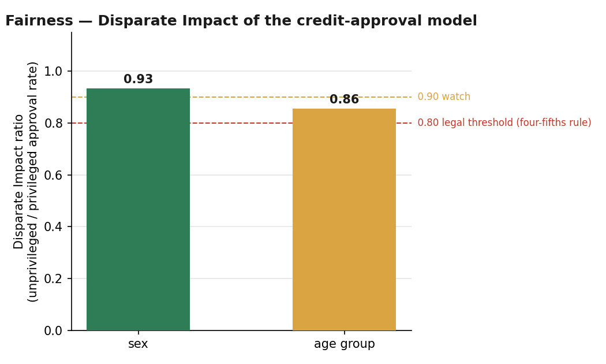
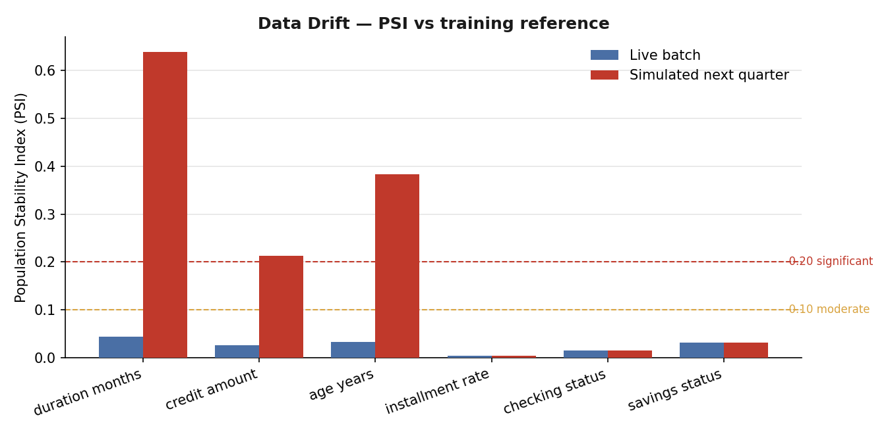

# Credit Decision — Bias & Data-Drift Audit

An AI-governance portfolio project auditing an **automated credit-decision model** for
two of the risks a governance/risk analyst is paid to catch: **unfair outcomes** and
**data drift**. Everything is computed from first principles (no black-box fairness
library) so the method is transparent and defensible.

**Author:** Femi Fayinminu · AI Governance & Security | Data Integrity & Requirements Analysis
**Companion write-up (Notion):** _[add link]_  ·  **Dataset:** UCI Statlog (German Credit Data)

---

## The question

A bank uses a model to approve or decline credit. Two questions a governance review must answer:

1. **Is it fair?** Does the model approve some demographic groups far less often than others —
   even though the protected attribute (sex) was never given to it as a feature?
2. **Is it still valid?** Have the inputs drifted away from the data the model was built on,
   so that yesterday's model is quietly making today's decisions on a different population?

## What it does

- Trains a logistic-regression approval model (sex **deliberately excluded** from the features,
  so we can test whether disparate impact appears anyway through proxy variables).
- **Fairness audit** on the model's approvals across protected groups:
  - **Disparate Impact (four-fifths / 80% rule)** — ratio of approval rates (unprivileged ÷ privileged).
  - **Demographic Parity difference** — gap in approval rates.
  - **Equal Opportunity difference** — gap in approval rates *among genuinely creditworthy applicants*.
- **Drift audit** using the **Population Stability Index (PSI)** per feature, with a simulated
  "next quarter" production batch so you can see the monitor fire.

### NIST AI RMF mapping
This operationalises the **MEASURE** function (quantify fairness + drift) and feeds **MANAGE**
(thresholds that trigger human review): DI < 0.80 = fail, 0.80–0.90 = watch; PSI ≥ 0.2 = significant drift.

## Run it

```bash
pip install -r requirements.txt
python credit_bias_drift_audit.py
```

The dataset downloads automatically (offline fallback: drop `german.data` beside the script).
Outputs land in `outputs/` and feed the Power BI dashboard:

| File | Contents |
|---|---|
| `outputs/data_quality_report.csv` | dtype, missing values, cardinality per column |
| `outputs/fairness_metrics.csv` | per-group rates + DI / parity / equal-opportunity summary |
| `outputs/drift_metrics.csv` | PSI per feature, live vs. simulated next batch |

## Findings (reproducible, fixed seed)

**Fairness**

| Protected attribute | Disparate impact | Demographic-parity gap | Equal-opportunity gap | Verdict |
|---|---|---|---|---|
| Sex (female vs male) | **0.93** | 0.05 | 0.03 | PASS (within 80% rule) |
| Age group (under-25 vs 25+) | **0.86** | 0.11 | 0.13 | **WATCH** |

Even though **sex was never a model input**, outcomes are close to parity on sex — but **age
shows a real signal**: applicants under 25 are approved at ~86% the rate of older applicants, and
the equal-opportunity gap (0.13) means that *even among genuinely creditworthy applicants*, younger
ones are approved less often. It sits above the 0.80 legal-red-flag line but inside the zone that
warrants investigation and a documented business justification.

**Drift** — PSI stays below 0.1 on the live test set (no drift, as expected), and the monitor
**correctly fires** on the simulated next-quarter batch: `duration_months` (0.64), `age_years`
(0.38) and `credit_amount` (0.21) all breach the 0.2 "significant" threshold, while unchanged
features stay quiet. This demonstrates a monitor that is silent when it should be and loud when it matters.

## Dashboard

Generate the visuals with `python make_charts.py` (reads the CSVs, writes to `charts/`):





## Recommended controls (the governance output)

- **Age**: require a documented, legitimate business justification for the age gap; add a
  recurring fairness check to the model's monitoring with DI as a tracked KPI.
- **Drift**: schedule the PSI check on each new batch; PSI ≥ 0.2 on any decision-relevant feature
  triggers a human review and a retraining decision before the model keeps deciding.
- **Proxies**: because disparate impact can appear without the protected attribute as a feature,
  audit *outcomes*, not just inputs.

## Honest limitations

- The target label is historical credit outcomes, which may themselves carry bias; a real audit
  would also examine label provenance.
- The "next quarter" drift is simulated to demonstrate the monitor; in production it runs on real batches.
- `foreign_worker` was excluded from the fairness view because the domestic subgroup is too small
  (~3.7% of records) for a stable rate — a real audit would flag it as "insufficient sample, monitor".

## Skills shown
Python · scikit-learn · pandas/numpy · fairness metrics · PSI drift detection · data-quality profiling ·
NIST AI RMF framing · translating technical findings into controls for non-technical leadership.
